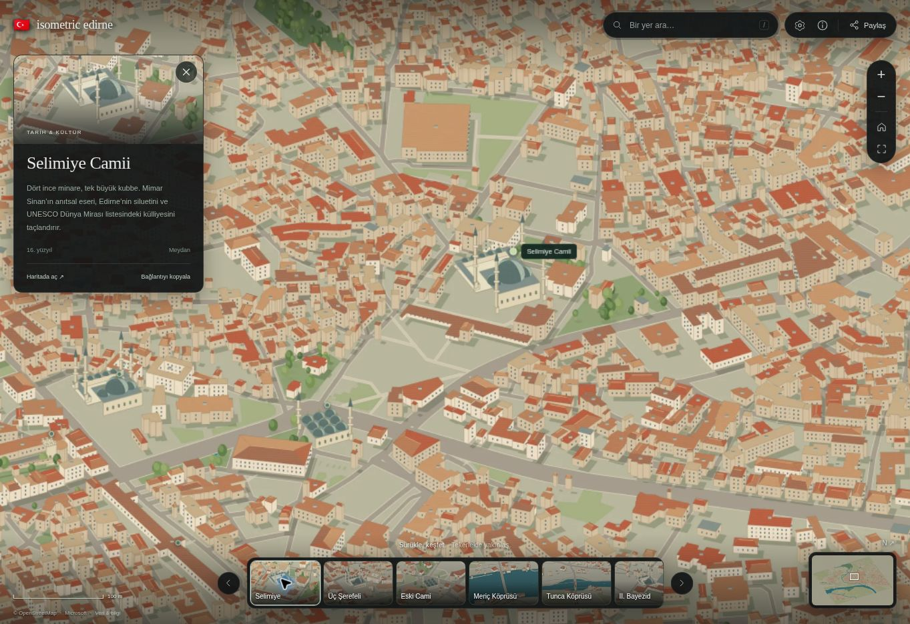

# Isometric Edirne

A full-screen, interactive isometric map of **Edirne / Merkez**, inspired by [Isometric Istanbul](https://isometricistanbul.com/) and [Isometric NYC](https://isometric.nyc/). Plain HTML, CSS, and JavaScript; original map rendering and landmark models.

**[Open the map](https://bozukartr.github.io/edirne-isometric/)**



## Version 2

The viewer now uses a pre-rendered, four-level **WebP tile pyramid**, rather than redrawing city geometry on every frame. Dragging and zooming update a compositor transform. Only visible image regions are requested, and there is no animation loop when the map is idle.

The map now includes **16,563 building footprints**: 2,904 from OpenStreetMap and 13,659 additional Microsoft open-building footprints after overlap filtering. Roofs, facades, windows, shadows, trees, and landmark models are rendered offline. A compact dark interface leaves the map visible, with search at the top, landmark thumbnails at the bottom, and an interactive minimap.

## Run

```sh
npm start
```

Open **http://localhost:5173**. No dependencies or API keys are needed to serve the included map. Alternatively:

```sh
python3 -m http.server 5173 --directory dist
```

## Controls

- Drag to pan; scroll, double-click, pinch, or use **+ / −** to zoom.
- Search Turkish place names with or without accents: `uc serefeli` and `karaagac` work.
- Select a landmark thumbnail or a map marker to view its details.
- Click the minimap to move to another part of the city.
- Settings: day/evening light, markers, neighborhood labels, and automatic/low/high detail.
- Share copies a link to the selected landmark or the current map view.
- Keyboard: arrows pan, Shift + arrows pan farther, + / − zoom, R resets, / searches, and Escape closes panels.
- The interface and place descriptions are in Turkish. Reduced-motion preferences are respected.

## Data and visual interpretation

Coverage: **26.511–26.595° E, 41.646–41.700° N**. This is the urban area of Merkez, Sarayiçi, Yeniimaret, and Karaağaç, rather than the entire rural district.

- Roads, waterways, land use, and original buildings: **© OpenStreetMap contributors**, ODbL 1.0; downloaded 2026-10-31.
- Additional building footprints: **Microsoft GlobalMLBuildingFootprints**, CDLA Permissive 2.0; 2026-08-13 dataset.
- OSM footprints take precedence where a Microsoft footprint substantially overlaps one.
- Some heights are sourced; the remainder are deterministic estimates. Vertical scale is emphasized for legibility. Roof materials, colors, windows, and trees are illustrative. Landmark models are simplified architectural interpretations. Terrain is flat; river widths are stylized where only centerlines are available.

See [data provenance and licenses](dist/data/README.md). The combined derivative database in `dist/data/map.js` is distributed under ODbL 1.0, retaining the Microsoft source notice and license. No reference-site imagery or code was copied.

## Rebuild the map images

The pre-rendered tiles are committed, so deployment needs no build step. To regenerate them after editing geometry or rendering:

```sh
npm install
npm run atlas
npm run pages
```

Only the offline image builder uses `@napi-rs/canvas`. It is not shipped to or run in the browser. The builder produces 116 WebP tiles at 0.25, 0.5, 1, and 2 pixels per meter, an overview, and 12 landmark thumbnails.

To refresh the OSM source, run `python3 scripts/prepare-data.py`. This replaces the combined snapshot with OSM-only data; then run `python3 scripts/import-microsoft-buildings.py` to merge the pinned Microsoft extract again, followed by `npm run atlas` and `npm run pages`.

## Verify

```sh
npm test
```

Twelve tests cover projections, pointer-anchored zoom, Turkish name search, geographic bounds, source counts, tile selection, resolution selection, the complete pyramid, thumbnails, and both HTML entry points. Desktop and 390 × 844 mobile layouts were checked in Chrome for navigation, search, place details, themes, and settings.

[Performance comparison and limitations](docs/performance.md)

## Publish

GitHub Pages is configured as **Deploy from a branch → `main` → `/ (root)`**. The root `index.html` loads assets from `dist/`; `.nojekyll` bypasses Jekyll. Pushes to `main` publish updates automatically.

Run `npm run pages` after changing `dist/index.html`. Keep `dist/atlas/` in the repository: it contains the published map images. You can also upload `dist/` to any static host. The application needs no server, map API, font CDN, analytics, or login.

## Structure

```text
index.html                 Generated GitHub Pages entry
.nojekyll                  Static Pages publication
dist/
  index.html               Application shell
  styles.css               Responsive dark map interface
  app.js                   Tile lifecycle, compositor camera, UI
  viewer-core.js           Pure tile/viewport math
  geometry.js              Geographic projection and zoom math
  atlas/                   Published WebP pyramid and thumbnails
  data/                    Offline source database and place directory
scripts/
  build-atlas.cjs           Offline map image generation
  lib/render-scene.cjs      Detailed geographic renderer
  prepare-pages.mjs        Generate root HTML entry
  prepare-data.py          Download and compile OSM data
  import-microsoft-buildings.py
  merge-buildings.py       Merge Microsoft footprints with OSM precedence
  serve.mjs                Dependency-free local server
tests/
  atlas.test.cjs
```
